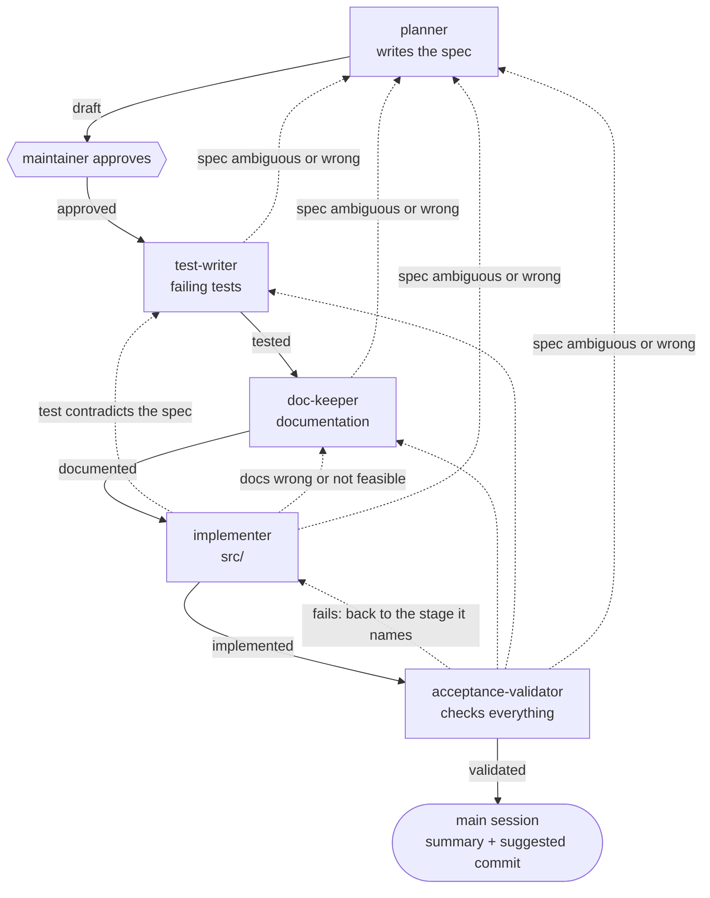

# Development workflow

This is the canonical description of how a change to ingestio is developed. Every change to
`src/` goes through it, with no exceptions. Changes that touch nothing in `src/`, such as CI,
tooling or a documentation fix, do not need it.

The flow is spec-driven and documentation-driven: the documentation comes before the
implementation on purpose. It describes the feature as if it already existed, and the
implementation exists to fulfil the spec, the tests and the documentation.

## Stages

```
planning → tests → documentation → implementation → validation
```

Each stage has a dedicated agent, defined in `.claude/agents/`.

| Stage | Agent | Model | Writes to | Never changes |
|---|---|---|---|---|
| Planning | `planner` | opus | `specs/` | code, tests, docs |
| Tests | `test-writer` | opus | `tests/` | specs, code, docs |
| Documentation | `doc-keeper` | sonnet | `docs/`, `.claude/kb/` | specs, code, tests |
| Implementation | `implementer` | sonnet | `src/` | specs, tests, docs |
| Validation | `acceptance-validator` | opus | nothing: reads and runs tests, lint and types | anything |

## The spec records the state

The spec in `specs/` is the record of where a change stands. Its status moves through:

```
draft → approved → tested → documented → implemented → validated
```

| Status | Set when | Next stage |
|---|---|---|
| `draft` | the planner writes or revises the spec | maintainer's approval |
| `approved` | the maintainer approves the spec explicitly | tests |
| `tested` | the test-writer finishes | documentation |
| `documented` | the doc-keeper finishes | implementation |
| `implemented` | the implementer finishes | validation |
| `validated` | the acceptance-validator passes the change | end of the flow |

An agent starts only when the spec is in the status right before its own. When it finishes,
the spec moves to the next status and its **History** section records a summary of what the
stage did. The agents report; the main session writes the status and the history entry, so
that every agent stays inside the directories of its own stage.

## Rules by stage

### Planning

The planner turns a request into a spec, from [`specs/_template.md`](../specs/_template.md),
and checks it against the [philosophy](philosophy.md): a change that fits neither connectors
nor callbacks stops there and is reported. The spec moves to `approved` only with the
maintainer's explicit approval. No other stage needs the maintainer's approval.

### Tests

The test-writer writes the tests from the acceptance criteria of the spec, before anything is
implemented. Every criterion `AT-001`, `AT-002`, ... has at least one test named
`test_at001_<description>`, in the spec's own test file, `tests/test_<slug>.py`, so that the
same criterion number in two specs never collides. At the end of this stage the new tests
fail for the expected reason, the missing feature, and not because of a mistake in the tests.

A spec may make the tests of some criteria opt-in, because they need something the stage cannot
run, such as a Spark session. Those tests are collected and skipped where the stage runs. The
test-writer shows that they are collected and skipped for the reason the spec gives, and that the
other tests fail for the missing feature.

### Documentation

The doc-keeper documents the feature from the spec and the tests, the way it will be used:
concepts, public API, examples. It does not describe internals that will only exist after the
implementation. It updates `docs/`, `.claude/kb/` and [`docs/index.md`](index.md).

Every `python` block in `docs/` is an example that runs as written; a block that cannot run
on its own, because it calls a network service for instance, carries
`<!-- example: skip -->` on the line above it.

### Implementation

The implementer reads the spec, the tests and the documentation before starting, and writes
code in `src/` until every test passes and the behaviour matches what the documentation
describes. It never changes tests or documentation to accommodate the implementation. A test that
the spec makes opt-in and that is skipped where the implementer runs does not count: the
implementer cannot run it, and the criterion is verified in CI.

### Validation

The acceptance-validator fails the change when:

- an acceptance criterion has no passing test, except a criterion whose tests the spec makes
  opt-in and which are skipped where the validation runs: it is reported as not run, with the
  reason, and does not fail the validation (see below);
- the implementation diverges from the documentation: examples, signatures, described
  behaviour;
- the philosophy or the constraints in [AGENTS.md](../AGENTS.md#constraints) were violated;
- lint or type checks fail.

It runs the documentation examples as part of the test suite
(`tests/test_docs_examples.py`). When it fails a change, it says which stage the change goes
back to.

**Skipped opt-in criteria.** A criterion whose tests the spec makes opt-in, and which are skipped
where the stage runs, is reported as not run and does not fail the validation: the report lists
each one. CI runs it after the maintainer pushes, and a failure there returns the change to the
stage it names, as any validation failure does.

## Returns

No agent solves a problem that belongs to another stage. It stops and hands the change back:

- the implementer finds a test wrong with respect to the spec: back to the **test-writer**;
- the implementer finds the documentation wrong or not feasible: back to the **doc-keeper**;
- any agent finds the spec ambiguous or wrong: back to the **planner**, and the spec needs
  the maintainer's approval again;
- the acceptance-validator fails the change: back to the stage it names.

A return sets the spec to the status right before the stage that receives it, and the flow
continues forward from there, running every later stage again:

| Back to | Spec status |
|---|---|
| planner | `draft` |
| test-writer | `approved` |
| doc-keeper | `tested` |
| implementer | `documented` |



## The main session

The main session is the conversation that runs the agents. It:

1. hands the request to the planner and presents the spec to the maintainer;
2. sets the spec to `approved` only after the maintainer's explicit approval;
3. runs each agent in order, after checking the spec status;
4. records each status change and stage summary in the spec's **History**;
5. on a return, sets the status from the table above, records the reason, and resumes the
   flow from the receiving stage;
6. at `validated`, gives the maintainer a summary of the change and a suggested commit message
   in Conventional Commits form, with no co-author trailers, and points out anything in
   `README.md` that the change makes outdated;
7. if the flow stops before `validated`, warns the maintainer, because the documentation may
   describe something that does not exist. Discarding the changes is the maintainer's call.

The main session never changes `src/` outside this flow. No agent commits: commits, pushes,
pull requests and merges belong to the maintainer.
